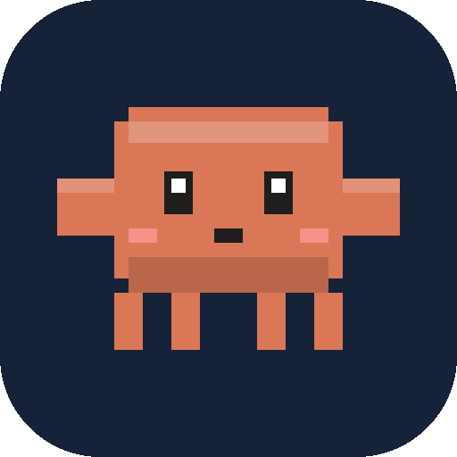
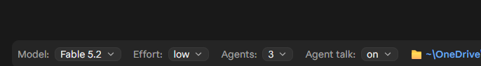
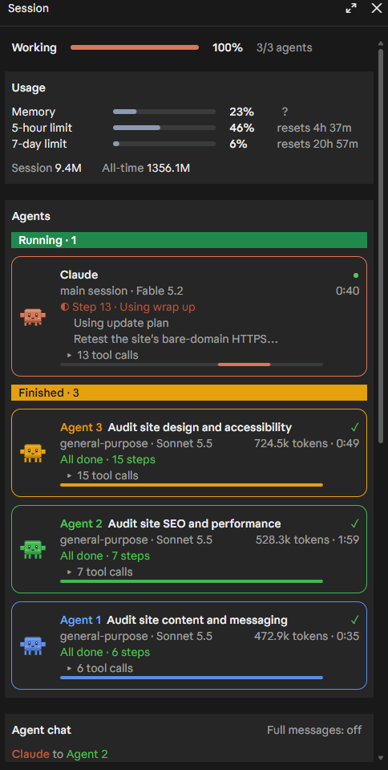

<p align="center"></p>

<h1 align="center">usage-meter for Claude Code</h1>

See what your Claude Code session is doing at a glance: how full the conversation is, how much of your limits you've used, which agents are working, what they say to each other, and which model each one runs on. Switch model, effort and agent count from a bar right above the chat box.

## 🖼️ Demo

**Control bar, right above the chat box**



**Session pane, docked on the right**



## ✨ What you get

### 🎛️ Control bar (above the chat box)

| Part | What it does |
|---|---|
| **Model** | Dropdown to switch between Opus, Sonnet, Haiku and Fable without typing `/model` |
| **Effort** | Dropdown for low, medium, high, xhigh or max |
| **Agents** | Ask Claude to split each task across 2 to 6 parallel agents, or leave it on "just Claude" |
| **Agent talk** | On or off. While on, every new agent is told to message the other agents working on the same request. Your choice is remembered across sessions |
| **📁 Folder** | The folder this session works in |

### 🧭 Session pane (docked on the right)

| Section | What it shows |
|---|---|
| **Working** | While Claude works: a bar with the current step ("Reading and understanding", "Making changes", "Running and checking"). With agents running, it counts finished agents instead |
| **Usage** | Three matching bars: conversation memory, your 5-hour limit and your 7-day limit, with reset times. Tokens used this session and all time |
| **Agents** | Every agent Claude starts, live, split into Running and Finished: its task, type, model, run time, tokens, current step and the two steps before it. Click "tool calls" to see what each one ran. Claude's own work has a row too |
| **Agent chat** | The conversation between Claude and its agents: the brief Claude gives each agent, messages agents send each other, and each agent's answer back. Speakers are colored to match their Agents row |
| **Setup** | The plugins, connectors and skills this session has actually used. Click a name to read what it does. What's turned on but unused is listed underneath |
| **Mascot** | A small Claude that walks while agents work, hops when a turn goes well and looks sad when one fails |

### 💬 Agent chat and Full messages

Agent chat shows short plain lines by default: the first sentence or two, with file paths, citations and markdown removed, so it reads like people talking.

Click **Full messages** in the Agent chat header to see each message exactly as it was written (up to 4,000 characters each). It is **off by default** and turns off again at the start of every session. The chat keeps the last 60 messages and shows 5 at a time; use Earlier and Later to page.

### 🧠 Model routing for agents

When Claude starts an agent without naming a model, the mod picks one from the agent's task description, so cheap work doesn't spend your limits on a big model:

| The task looks like | Model |
|---|---|
| Finding, searching, listing, reading, summarizing, fetching, checking | **Haiku** |
| Writing code, building, fixing, editing, testing, anything else | **Sonnet** |
| Planning, architecture, tradeoffs, strategy, memos and essays, combining results | **Opus** |

The rules, in order:

1. A model Claude (or you) named in the Agent call is always kept.
2. An `Explore` agent runs on Haiku. A `Plan` agent runs on Opus.
3. Only the general agent types are routed (`general-purpose`, `claude`, `Explore`, `Plan`). A custom agent type keeps the model its own definition names.
4. A task that mixes reading with building ("read and fix the parser") counts as building, so it gets Sonnet.
5. A fork always runs on the session's model.

Each agent's row shows the model it ended up on. Your own session's model never changes by itself: use the **Model** dropdown for that.

### 🔔 Alerts

- A popup and a system notification when your 5-hour or 7-day limit crosses 80% and again at 95%.
- A popup when conversation memory reaches 85%, before Claude starts compressing older messages.

## 🚀 Install

You need Claude Code **2.1.275 or later** (terminal or the desktop app's Code tab).

In any Claude Code session, type:

```
/plugin install usage-meter --marketplace Rezwan3App/claude-usage-meter-mod
```

1. Answer `y` when it asks to add the marketplace.
2. Press Enter to install for your user (all your projects).
3. That's it. The bar shows up above the chat box, and the Session pane opens on its own.

> 💡 If the window is narrow when a session starts, the pane opens with your first message instead. Type `/usage-meter` to open it any time. If you close it by hand, it stays closed until the next session.

### Update

```
/plugin update usage-meter
```

### Install from a copy on your computer

Clone the repo, then point Claude Code at the folder in `~/.claude/settings.json`:

```json
{
  "env": {
    "CLAUDE_CODE_PLUGIN_DIRS": "/path/to/claude-usage-meter-mod"
  }
}
```

On Windows use `C:\\Users\\you\\claude-usage-meter-mod`. Separate several folders with `;` on Windows or `:` on macOS and Linux. Restart Claude Code after saving.

## ⚙️ Settings

Open `/config` and find **usage-meter**.

| Setting | Default | What it does |
|---|---|---|
| **Block em dashes** | Off | When on, Claude can't save an em dash into a `.md`, `.txt`, `.html` or `.csv` file (or any file name). It's told to rewrite with a comma, period, colon or parentheses instead. Handy if you keep a no-em-dash writing style |

Switches that live in the interface instead of `/config`:

| Switch | Where | Default |
|---|---|---|
| **Agent talk** | Control bar | On, remembered across sessions |
| **Full messages** | Agent chat header | Off, resets every session |
| **Agents** | Control bar | Just Claude |

## 🔒 Privacy

Everything stays on your computer. The mod reads:

- your session's own usage numbers, tool calls and agent messages from Claude Code, including the tool calls already in the transcript when a session resumes
- `~/.claude/plugins/installed_plugins.json` and each plugin's manifest, for the plugin list
- `~/.claude/settings.json`, only for which plugins are turned on
- `~/.claude.json`, only for the names of claude.ai connectors you've connected

Token totals, the last limit reading, which limit alerts you've already seen and your Agent talk choice are saved in Claude Code's plugin storage so they survive restarts. Agent chat lives in the session only. Nothing is sent anywhere.

## 🧩 Good to know

- **Agents dropdown:** picking 2 or more adds one line to each message you send (slash commands excepted) asking Claude to split the work across that many agents. It's a request, not a hard limit; small tasks may still use fewer.
- **Agent talk:** it adds a short note to each agent's brief. Agents still decide whether they have anything worth saying, so a simple task may show only briefs and answers.
- **Model routing:** it matches keywords in the agent's short description. A description that fits nothing lands on Sonnet. If a pick is wrong, name the model in your request ("use an Opus agent for this").
- **Working percent:** the steps are based on what kind of tool Claude is using, not true progress. The bar only moves forward and disappears when the turn finishes.
- **Connectors:** a connector shows by name when Claude Code reports its name. One that reports only an ID shows as "Connector" plus the first part of the ID; add it to `CONNECTOR_IDS` in `hooks/register.tsx` to name it.
- **Colors:** the pane's panels are tuned for the dark theme.

## 🛠️ Troubleshooting

| Problem | Fix |
|---|---|
| Nothing shows up | Run `claude --version` and update if it's older than 2.1.275. Then start a new session |
| Bar shows but no pane | The window was too narrow at start. Send a message or type `/usage-meter` |
| Limit bars are empty with a dash | No reading yet. They fill in after the first reply. If they never do, your Claude Code build isn't passing limit data to mods |
| Agent chat is missing | It appears with the first agent Claude starts. Setting **Agents** to 2 or more asks Claude to use agents on your next message |
| Agents never message each other | Check **Agent talk** is on. It applies to agents started after you switch it |
| A dim line in the chat names `usage-meter` | That's the error. Open an issue and paste the line |

## 🗑️ Uninstall

```
/plugin uninstall usage-meter
```

If you installed from a folder, remove its path from `CLAUDE_CODE_PLUGIN_DIRS`.

## 👩‍💻 Develop

```bash
claude plugin validate .
claude plugin test .
```

`hooks/register.tsx` holds the whole mod and `types/index.d.ts` declares the values it keeps. Tests live next to the module as `*.test.ts`. Loading the folder through `CLAUDE_CODE_PLUGIN_DIRS` with `CLAUDE_CODE_PLUGIN_DIR_WATCH=1` reloads it each time you save.

## 📝 Changelog

**1.1.0**

- Agent chat: Claude's briefs, agent-to-agent messages and agent answers, with a **Full messages** switch (off by default).
- **Agent talk** switch in the control bar.
- Model routing for agents: Haiku, Sonnet or Opus by task.
- Agents split into Running and Finished, with live steps, paging and a row for Claude.
- Setup lists what the session has actually used, including skills.
- Limit alerts at 80% and 95%.
- Usage shows three matching bars; the Working bar moved into the pane.

**1.0.0**

- First release: Session pane and control bar.

## 📄 License

MIT. Made by [Rezwan Islam](https://www.buildwithrez.com).
