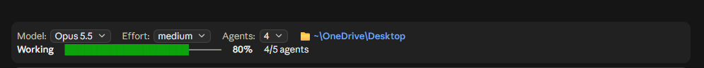
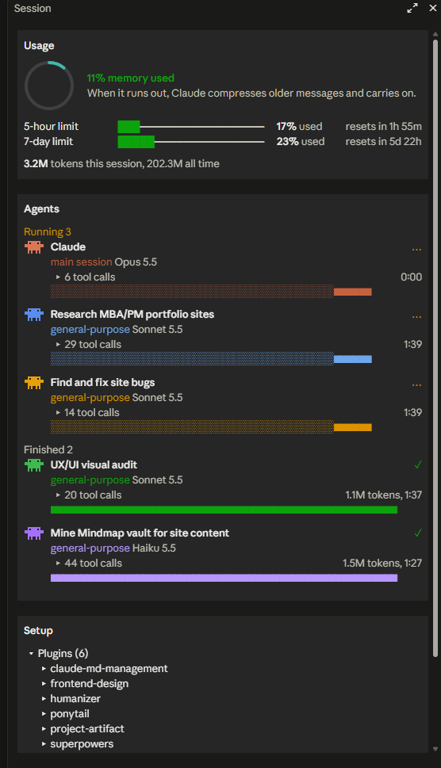

# 📊 usage-meter for Claude Code

See what your Claude Code session is doing at a glance: how full the conversation is, how much of your limits you've used, which agents are working, and which model you're on. Switch model, effort and agent count from a bar right above the chat box.

<p>
  
</p>

<p>
  
</p>

## ✨ What you get

### 🎛️ Control bar (above the chat box)

| Part | What it does |
|---|---|
| **Model** | Dropdown to switch between Opus, Sonnet, Haiku and Fable without typing `/model` |
| **Effort** | Dropdown for low, medium, high, xhigh or max |
| **Agents** | Ask Claude to split each task across 2 to 6 parallel agents, or leave it on "just Claude" |
| **📁 Folder** | The folder this session works in |
| **Progress** | While Claude works: a bar from 0 to 100% with the current step ("Reading and understanding", "Making changes", "Running and checking"). With agents running, it counts finished agents instead |

### 🧭 Session pane (docked on the right)

| Section | What it shows |
|---|---|
| **Usage** | A ring for how much conversation memory is used. You get a heads-up popup at 85%, before Claude starts compressing older messages. Bars for your 5-hour and 7-day limits with reset times, and tokens used this session and all time |
| **Agents** | Every agent Claude starts, live: its task, type, model, run time, tokens and tool calls. Click "tool calls" to see what each one ran |
| **Setup** | Fold-out lists of your installed plugins and connected claude.ai connectors. Click any name to read what it does |
| **Mascot** | A small Claude that hops when a turn goes well and looks sad when one fails |

## 🚀 Install

You need Claude Code **2.1.275 or later** (terminal or the desktop app's Code tab).

In any Claude Code session, type:

```
/plugin install usage-meter --marketplace Rezwan3App/claude-usage-meter
```

1. Answer `y` when it asks to add the marketplace.
2. Press Enter to install for your user (all your projects).
3. That's it. The bar shows up above the chat box, and the Session pane opens on its own.

> 💡 If the window is narrow when a session starts, the pane opens with your first message instead. Type `/usage-meter` to open it any time.

### Install from a copy on your computer

Clone the repo, then point Claude Code at the folder in `~/.claude/settings.json`:

```json
{
  "env": {
    "CLAUDE_CODE_PLUGIN_DIRS": "/path/to/claude-usage-meter"
  }
}
```

On Windows use `C:\\Users\\you\\claude-usage-meter`. Separate several folders with `;` on Windows or `:` on macOS and Linux. Restart Claude Code after saving.

## ⚙️ Settings

Open `/config` and find **usage-meter**.

| Setting | Default | What it does |
|---|---|---|
| **Block em dashes** | Off | When on, Claude can't save an em dash into a `.md`, `.txt`, `.html` or `.csv` file (or any file name). It's told to rewrite with a comma, period, colon or parentheses instead. Handy if you keep a no-em-dash writing style |

## 🔒 Privacy

Everything stays on your computer. The mod reads:

- your session's own usage numbers from Claude Code
- `~/.claude/plugins/installed_plugins.json` and each plugin's manifest, for the plugin list
- `~/.claude.json`, only for the names of claude.ai connectors you've connected

Token totals are saved in Claude Code's plugin storage so the "all time" number survives restarts. Nothing is sent anywhere.

## 🧩 Good to know

- **Agents dropdown:** picking 2 or more adds one line to each message asking Claude to split the work across that many agents. It's a request, not a hard limit; small tasks may still use fewer.
- **Progress percent:** the steps are based on what kind of tool Claude is using, not true progress. The bar only moves forward and ends at 100% when the turn finishes.
- **Connectors list:** it shows connectors your claude.ai account has connected. One you removed recently may still be listed.
- **Folder-search agents:** an `Explore` agent started without a model runs on Haiku to save your limits.

## 🛠️ Troubleshooting

| Problem | Fix |
|---|---|
| Nothing shows up | Run `claude --version` and update if it's older than 2.1.275. Then start a new session |
| Bar shows but no pane | The window was too narrow at start. Send a message or type `/usage-meter` |
| Limits show "no reading" | Your Claude Code build isn't passing limit data to mods yet. The rest of the pane still works |
| A dim line in the chat names `usage-meter` | That's the error. Open an issue and paste the line |

## 🗑️ Uninstall

```
/plugin uninstall usage-meter
```

If you installed from a folder, remove its path from `CLAUDE_CODE_PLUGIN_DIRS`.

## 👩‍💻 Develop

```bash
claude plugin validate .
claude plugin test .
```

`hooks/register.tsx` holds the whole mod. Tests live next to it as `*.test.ts`. Loading the folder through `CLAUDE_CODE_PLUGIN_DIRS` with `CLAUDE_CODE_PLUGIN_DIR_WATCH=1` reloads it each time you save.

## 📄 License

MIT. Made by [Rezwan Islam](https://buildwithrez.com).
